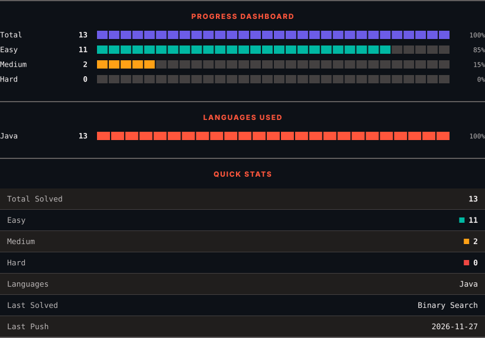
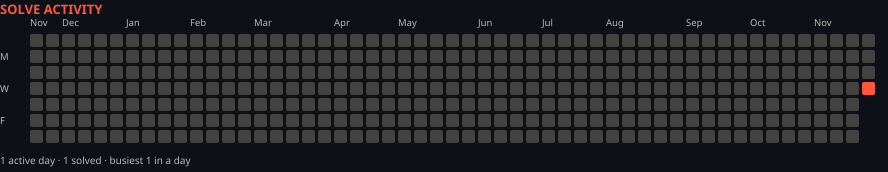

<h1>LeetCode Solutions</h1>

<em>Automatically synced with every accepted submission</em>

   

<picture>
  <source media="(prefers-color-scheme: dark)" srcset=".leetsync/stats-dark.svg">
  <source media="(prefers-color-scheme: light)" srcset=".leetsync/stats-light.svg">
  
</picture>

<picture>
  <source media="(prefers-color-scheme: dark)" srcset=".leetsync/calendar-dark.svg">
  <source media="(prefers-color-scheme: light)" srcset=".leetsync/calendar-light.svg">
  
</picture>

---

### ALL SOLUTIONS

| # | Problem | Difficulty | Language | Date |
|:---:|:--------|:----------:|:--------:|:----:|
| 1 | [Two Sum](problems/0001-Two-Sum) | 🟩 Easy | `Java` | 2026-11-25 |
| 9 | [Palindrome Number](problems/0009-Palindrome-Number) | 🟩 Easy | `Java` | 2026-11-26 |
| 49 | [Group Anagrams](problems/0049-Group-Anagrams) | 🟧 Medium | `Java` | 2026-11-26 |
| 110 | [Balanced Binary Tree](problems/0110-Balanced-Binary-Tree) | 🟩 Easy | `Java` | 2026-11-26 |
| 121 | [Best Time to Buy and Sell Stock](problems/0121-Best-Time-to-Buy-and-Sell-Stock) | 🟩 Easy | `Java` | 2026-11-26 |
| 122 | [Best Time to Buy and Sell Stock II](problems/0122-Best-Time-to-Buy-and-Sell-Stock-II) | 🟧 Medium | `Java` | 2026-11-26 |
| 125 | [Valid Palindrome](problems/0125-Valid-Palindrome) | 🟩 Easy | `Java` | 2026-11-27 |
| 217 | [Contains Duplicate](problems/0217-Contains-Duplicate) | 🟩 Easy | `Java` | 2026-11-26 |
| 242 | [Valid Anagram](problems/0242-Valid-Anagram) | 🟩 Easy | `Java` | 2026-11-26 |
| 704 | [Binary Search](problems/0704-Binary-Search) | 🟩 Easy | `Java` | 2026-11-26 |

---

Auto-synced by <strong>LeetSync</strong> · Built by <a href="https://deveshsamant.in/">Devesh Samant</a>

