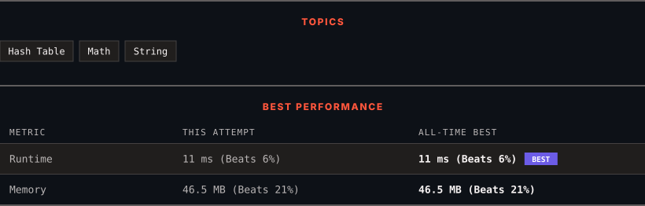

<div align="center">

# 12. Integer to Roman

      

[](https://leetcode.com/problems/integer-to-roman/)

</div>

---

<div align="center">

<picture>
  <source media="(prefers-color-scheme: dark)" srcset="panel-dark.svg">
  <source media="(prefers-color-scheme: light)" srcset="panel-light.svg">
  
</picture>

</div>

> **New personal best** — Runtime improved on this submission.

### HOW IT WENT

| | |
|:--|:--|
| **Attempts** | 3 before accepted |
| **Time to solve** | 9 min |
| **Verdicts** | 🔧 Compile Error → 🔧 Compile Error → ✅ Accepted |

---

### NOTES

_No notes yet._

---

### SOLUTIONS (1)

| # | File | Language | Date |
|:-:|------|:--------:|:----:|
| 1 | [sol1.java](./sol1.java) | `Java` | 2026-11-27 ← **latest** |

---

### PROBLEM DESCRIPTION

Seven different symbols represent Roman numerals with the following values:

	
		
			Symbol
			Value
		
	
	
		
			I
			1
		
		
			V
			5
		
		
			X
			10
		
		
			L
			50
		
		
			C
			100
		
		
			D
			500
		
		
			M
			1000
		
	

Roman numerals are formed by appending the conversions of decimal place values from highest to lowest. Converting a decimal place value into a Roman numeral has the following rules:

	- If the value does not start with 4 or 9, select the symbol of the maximal value that can be subtracted from the input, append that symbol to the result, subtract its value, and convert the remainder to a Roman numeral.

	- If the value starts with 4 or 9 use the **subtractive form** representing one symbol subtracted from the following symbol, for example, 4 is 1 (`I`) less than 5 (`V`): `IV` and 9 is 1 (`I`) less than 10 (`X`): `IX`. Only the following subtractive forms are used: 4 (`IV`), 9 (`IX`), 40 (`XL`), 90 (`XC`), 400 (`CD`) and 900 (`CM`).

	- Only powers of 10 (`I`, `X`, `C`, `M`) can be appended consecutively at most 3 times to represent multiples of 10. You cannot append 5 (`V`), 50 (`L`), or 500 (`D`) multiple times. If you need to append a symbol 4 times use the **subtractive form**.

Given an integer, convert it to a Roman numeral.

 

**Example 1:**

**Input:** num = 3749

**Output:** "MMMDCCXLIX"

**Explanation:**

```

3000 = MMM as 1000 (M) + 1000 (M) + 1000 (M)
 700 = DCC as 500 (D) + 100 (C) + 100 (C)
  40 = XL as 10 (X) less of 50 (L)
   9 = IX as 1 (I) less of 10 (X)
Note: 49 is not 1 (I) less of 50 (L) because the conversion is based on decimal places

```

**Example 2:**

**Input:** num = 58

**Output:** "LVIII"

**Explanation:**

```

50 = L
 8 = VIII

```

**Example 3:**

**Input:** num = 1994

**Output:** "MCMXCIV"

**Explanation:**

```

1000 = M
 900 = CM
  90 = XC
   4 = IV

```

 

**Constraints:**

	- `1 <= num <= 3999`

---

<div align="center">

<sub>Auto-synced by <strong>LeetSync</strong> · Built by <a href="https://deveshsamant.in/">Devesh Samant</a></sub>

</div>
