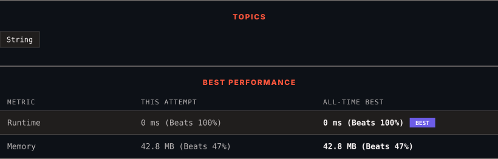

<div align="center">

# 58. Length of Last Word

      

[](https://leetcode.com/problems/length-of-last-word/)

</div>

---

<div align="center">

<picture>
  <source media="(prefers-color-scheme: dark)" srcset="panel-dark.svg">
  <source media="(prefers-color-scheme: light)" srcset="panel-light.svg">
  
</picture>

</div>

> **New personal best** — Runtime improved on this submission.

### HOW IT WENT

| | |
|:--|:--|
| **Attempts** | 3 before accepted |
| **Time to solve** | 12 min |
| **Verdicts** | 🔧 Compile Error → ❌ Wrong Answer → ✅ Accepted |

---

### NOTES

_No notes yet._

---

### SOLUTIONS (1)

| # | File | Language | Date |
|:-:|------|:--------:|:----:|
| 1 | [sol1.java](./sol1.java) | `Java` | 2026-11-27 ← **latest** |

---

### PROBLEM DESCRIPTION

Given a string `s` consisting of words and spaces, return *the length of the **last** word in the string.*

A **word** is a maximal substring consisting of non-space characters only.

 

**Example 1:**

```

**Input:** s = "Hello World"
**Output:** 5
**Explanation:** The last word is "World" with length 5.

```

**Example 2:**

```

**Input:** s = "   fly me   to   the moon  "
**Output:** 4
**Explanation:** The last word is "moon" with length 4.

```

**Example 3:**

```

**Input:** s = "luffy is still joyboy"
**Output:** 6
**Explanation:** The last word is "joyboy" with length 6.

```

 

**Constraints:**

	- `1 <= s.length <= 10^4`

	- `s` consists of only English letters and spaces `' '`.

	- There will be at least one word in `s`.

---

<div align="center">

<sub>Auto-synced by <strong>LeetSync</strong> · Built by <a href="https://deveshsamant.in/">Devesh Samant</a></sub>

</div>
