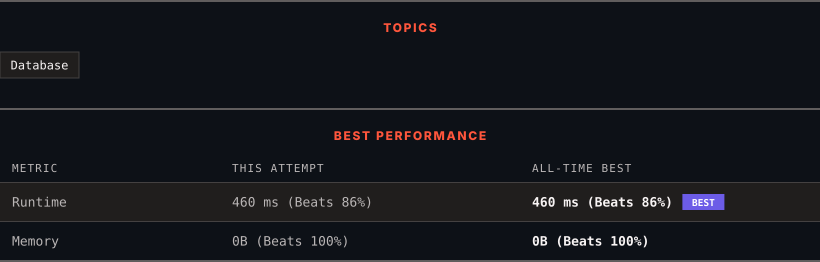

<div align="center">

# 175. Combine Two Tables

      

[](https://leetcode.com/problems/combine-two-tables/)

</div>

---

<div align="center">

<picture>
  <source media="(prefers-color-scheme: dark)" srcset="panel-dark.svg">
  <source media="(prefers-color-scheme: light)" srcset="panel-light.svg">
  
</picture>

</div>

> **New personal best** — Runtime improved on this submission.

### HOW IT WENT

| | |
|:--|:--|
| **Attempts** | first try |
| **Time to solve** | under a minute |
| **Verdicts** | ✅ Accepted |

---

### NOTES

_No notes yet._

---

### SOLUTIONS (1)

| # | File | Language | Date |
|:-:|------|:--------:|:----:|
| 1 | [sol1.sql](./sol1.sql) | `Oracle SQL` | 2026-11-27 ← **latest** |

---

### PROBLEM DESCRIPTION

Table: `Person`

```

+-------------+---------+
| Column Name | Type    |
+-------------+---------+
| personId    | int     |
| lastName    | varchar |
| firstName   | varchar |
+-------------+---------+
personId is the primary key (column with unique values) for this table.
This table contains information about the ID of some persons and their first and last names.

```

 

Table: `Address`

```

+-------------+---------+
| Column Name | Type    |
+-------------+---------+
| addressId   | int     |
| personId    | int     |
| city        | varchar |
| state       | varchar |
+-------------+---------+
addressId is the primary key (column with unique values) for this table.
Each row of this table contains information about the city and state of one person with ID = PersonId.

```

 

Write a solution to report the first name, last name, city, and state of each person in the `Person` table. If the address of a `personId` is not present in the `Address` table, report `null` instead.

Return the result table in **any order**.

The result format is in the following example.

 

**Example 1:**

```

**Input:** 
Person table:
+----------+----------+-----------+
| personId | lastName | firstName |
+----------+----------+-----------+
| 1        | Wang     | Allen     |
| 2        | Alice    | Bob       |
+----------+----------+-----------+
Address table:
+-----------+----------+---------------+------------+
| addressId | personId | city          | state      |
+-----------+----------+---------------+------------+
| 1         | 2        | New York City | New York   |
| 2         | 3        | Leetcode      | California |
+-----------+----------+---------------+------------+
**Output:** 
+-----------+----------+---------------+----------+
| firstName | lastName | city          | state    |
+-----------+----------+---------------+----------+
| Allen     | Wang     | Null          | Null     |
| Bob       | Alice    | New York City | New York |
+-----------+----------+---------------+----------+
**Explanation:** 
There is no address in the address table for the personId = 1 so we return null in their city and state.
addressId = 1 contains information about the address of personId = 2.

```

---

<div align="center">

<sub>Auto-synced by <strong>LeetSync</strong> · Built by <a href="https://deveshsamant.in/">Devesh Samant</a></sub>

</div>
